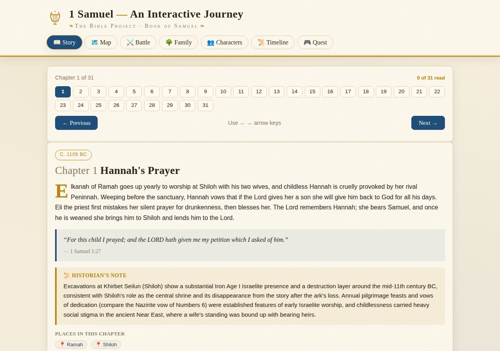
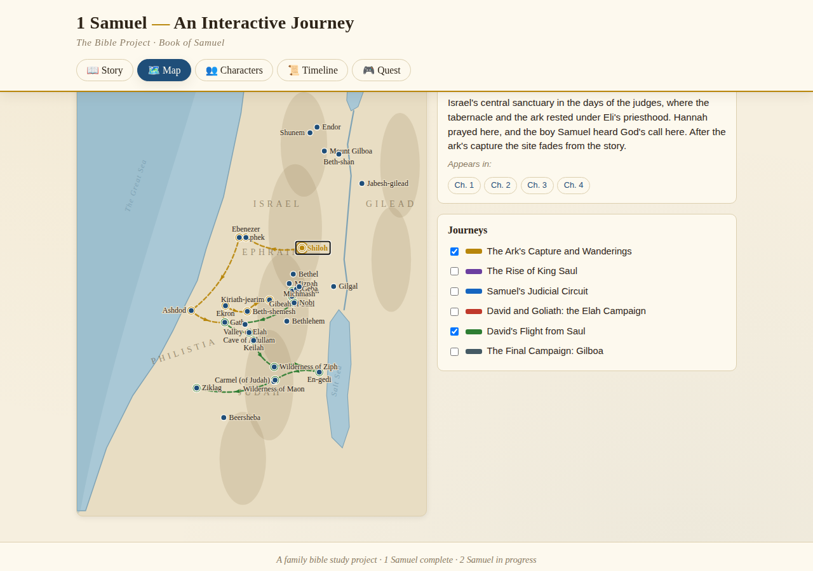
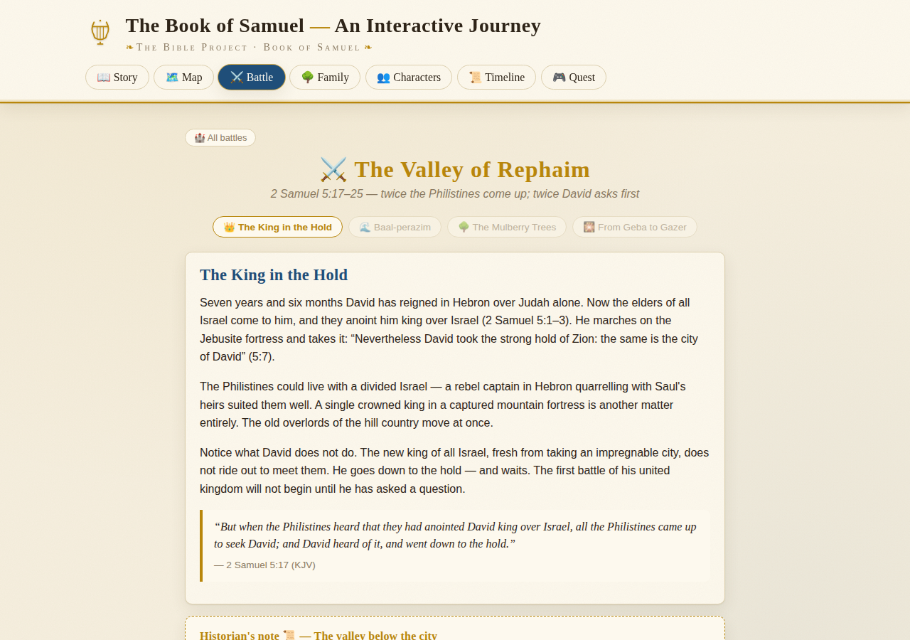
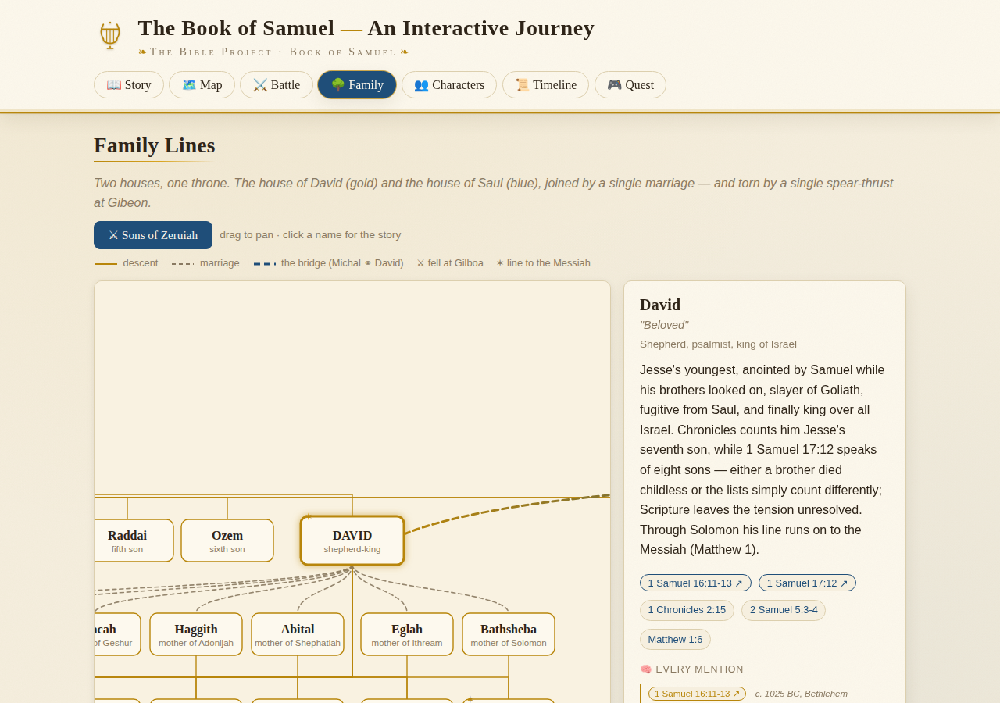
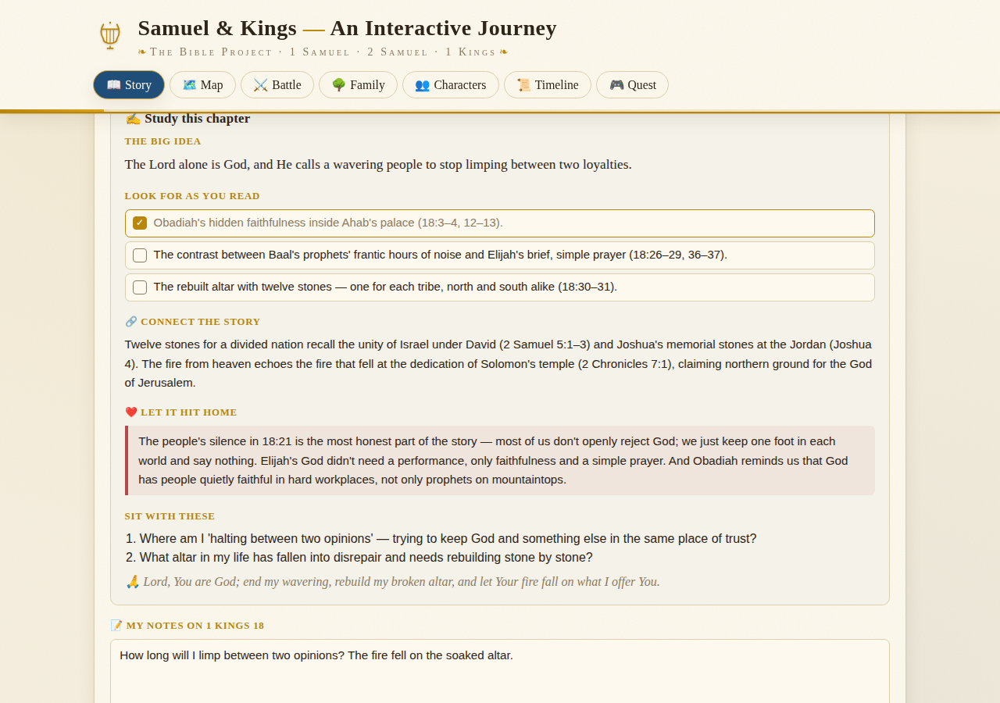
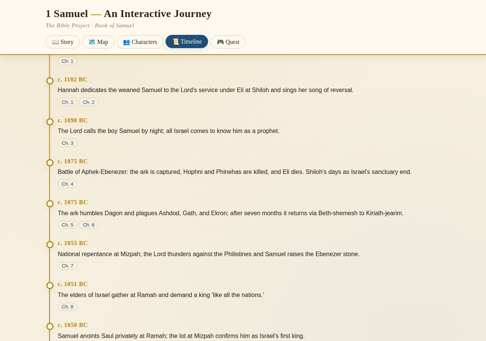
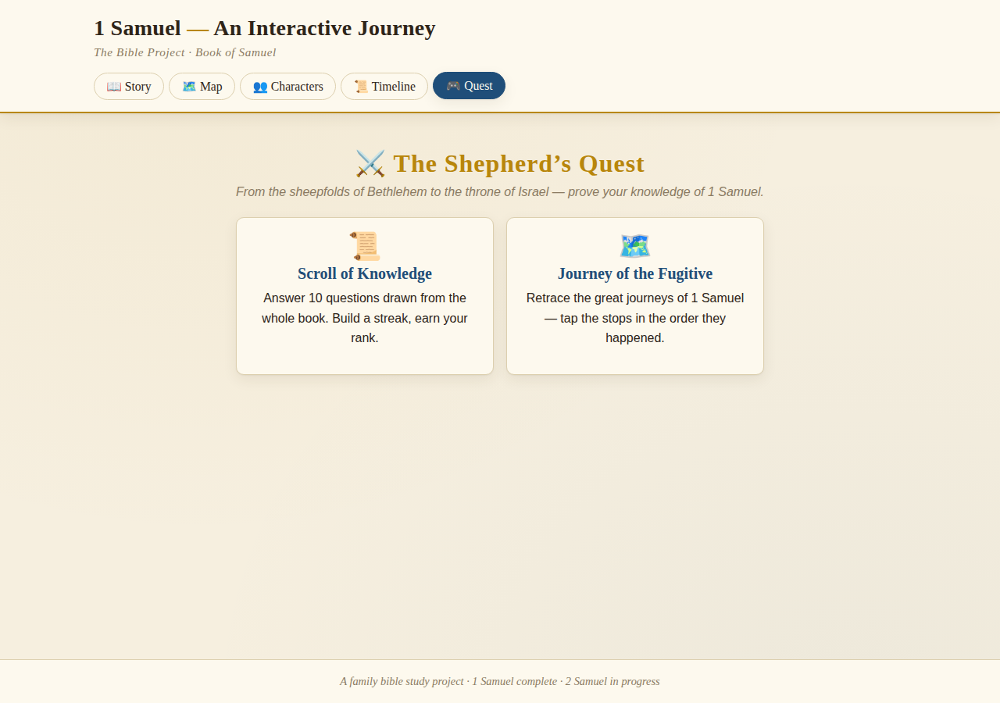

# Samuel & Kings — An Interactive Journey

**An interactive, offline-capable study of 1-2 Samuel and 1-2 Kings for families and small groups: every chapter, a clickable map, playable battles, a family tree and a quest, in one folder of plain HTML.**

**▶ Play it live: [oscar-leung.github.io/bible-project](https://oscar-leung.github.io/bible-project/)**

[](https://github.com/oscar-leung/bible-project/actions/workflows/pages.yml)
[](LICENSE)

[](https://oscar-leung.github.io/bible-project/)

<details>
<summary>More screenshots</summary>

| Map with journey routes | A playable battle | Family lines |
|---|---|---|
|  |  |  |

| Kings study page | Timeline | Quest |
|---|---|---|
|  |  |  |

</details>

## Why it exists

Our family studied Samuel chapter by chapter with the Living by the Book method and kept outgrowing the notebook. Commentaries answer questions one at a time; a map, a timeline and a family tree answer them all at once. Nothing we found put the text, the geography and the people in one place without a login, an app store or a subscription, so this does. It is one folder, it works from `file://`, and the study notes are the family's own.

## What's inside

- **📖 Story** — every chapter with a summary, KJV key verse,
  archaeology-grounded historian's note, and 🎭 *Voices*: script-style KJV dialogue
  scenes with commentary. Chapters the family has studied also carry **📓 From the
  study notebook** — the theme in the reader's own words, the sharpest observations,
  and takeaways from real chapter-by-chapter devotional study (Living by the Book
  method).
- **✍️ Study (Kings)** — every Kings chapter adds the big idea, a "look for as you
  read" checklist, a link back to Samuel, "let it hit home", journaling questions, a
  prayer, a key-verse memorizer, private notes that copy straight into a study sheet,
  and a "Before you read" primer with every king's report card.
- **❓ Questions** — under each chapter: 180 common questions readers ask (the bears, the
  lying spirit, Jehu's bloodshed, the 185,000, the shadow on the dial…) with honest, text-grounded answers; a public
  Discussion thread (GitHub Discussions via giscus, once switched on); and a private
  "My questions" list.
- **🗺️ Map** — an SVG map of ancient Israel in a real lat/lon projection: 81 clickable
  places and 22 toggleable journey routes, from the ark's wanderings to the road to Babylon.
- **⚔️ Battles** — three playable retellings where every choice lands on the text:
  the pool of Gibeon (2 Sam 2), the valley of Rephaim (2 Sam 5), and the wood of
  Ephraim (2 Sam 18).
- **🌳 Family Lines** — a 49-person genealogy of the houses of David and Saul, each
  person carrying a "neuron map" of every mention and connection.
- **👥 Characters · 📜 Timeline** — 130 character studies and a 96-event chronology
  from Hannah's vow to Jehoiachin eating at Babylon's table.
- **🎮 Quest** — a 151-question scroll of knowledge spanning Samuel and Kings, plus a
  journey-ordering game. Eight hidden mysteries await the curious.

The map also keeps a running **Kings trail**: chapters you mark as read light up their
places in order. Deep links work everywhere: `#story/2s18`, `#story/1k18`, `#story/2k5`, `#battle/rephaim`, `#family/david`,
`#map/jerusalem`.

## Stack

- Plain HTML, CSS and JavaScript. No framework, no bundler, no build step.
- Content lives in `data/*.js` (chapters, characters, journeys, battles, FAQ) and is loaded by `js/`.
- Inline SVG for the map, in a real latitude and longitude projection.
- A service worker (`sw.js`) and web manifest make it installable and usable offline.
- Deployed by `.github/workflows/pages.yml` to GitHub Pages on every push to `main`.

See `ARCHITECTURE.md` for the zero-build design rules.

## Run it

```bash
git clone https://github.com/oscar-leung/bible-project
cd bible-project
python3 -m http.server 8000   # or just open index.html
```

Open http://localhost:8000. Opening `index.html` directly from the file system works too; the service worker is the only thing that needs a server.

## Tests

There is no automated suite yet. Each release is checked by hand against the checklist in `AUDIT.md`. The next step is a Playwright smoke test that opens every tab and every deep-link pattern in CI, so the Pages badge above can be joined by a real test badge.

## What is next

- The Playwright smoke test above.
- GitHub Discussions via giscus for the Questions tab (wired, not switched on).
- Chronicles, once Kings is fully annotated from the study notebook.

## Kinship

This project follows the path of, and gladly points to,
[books-of-samuel](https://github.com/elinxie/books-of-samuel) — a historically
serious 3D visualizer of the same two books
([live](https://elinxie.github.io/books-of-samuel/)). This study companion grew up
alongside that Bible Project's approach — every visual element traceable to the
biblical text, archaeology, or an honest "scholars differ" — and doesn't deviate
from its story. Go see it.

## Colophon

A family bible study project. All scripture quotations are KJV (public domain).
Dates follow a common conservative chronology and are approximate; historian notes
flag where scholarship is divided. See `DEVLOG.md` for how this was built, session
by session, and `ARCHITECTURE.md` for the zero-build design rules.

## License

Code is MIT, see [LICENSE](LICENSE). Scripture quotations are KJV (public domain). The study notes, historian notes, questions and answers in `data/` are © Oscar Leung and are shared under the same MIT terms; attribution appreciated.
